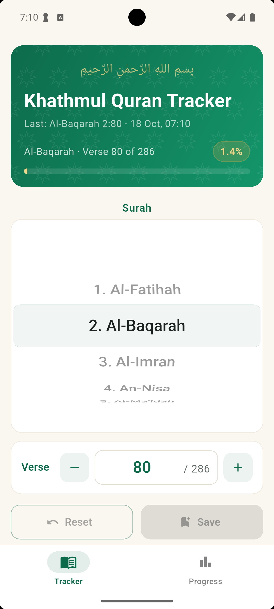
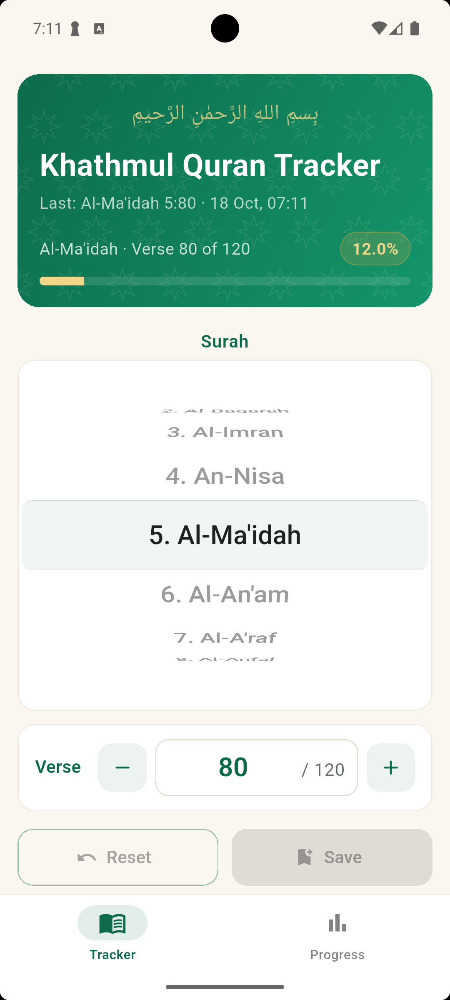
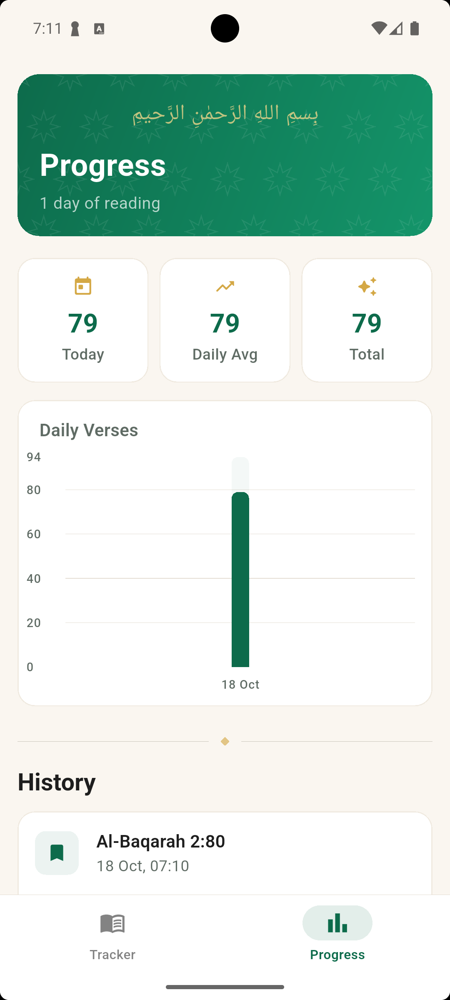
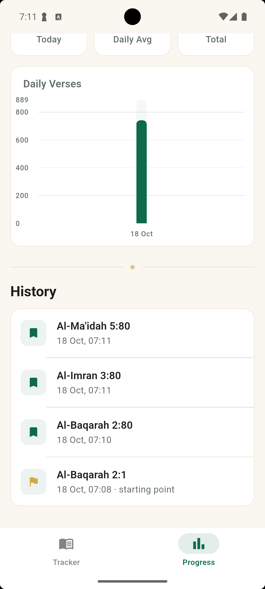

# Khathmul Quran Tracker

Track your Quran reading progress with daily stats, beautiful charts, and surah bookmarks.

<p align="center">
  
  
  
  
</p>

## Features

- Save your current reading position by surah and verse
- See your overall Quran completion percentage at a glance
- View daily verses read in an interactive bar chart
- Track stats: today's reading, daily average, and total verses read
- Browse your full reading history with timestamps
- Beautiful Islamic-inspired design with emerald and gold theme
- Works offline — all data stored locally on your device
- Supports light and dark mode

## Getting Started

```bash
flutter pub get
flutter run
```

## Build

```bash
# Android release bundle
flutter build appbundle --release

# Web
flutter build web --release
```

## Live

Web version available at [kqt.vercel.app](https://kqt.vercel.app)
